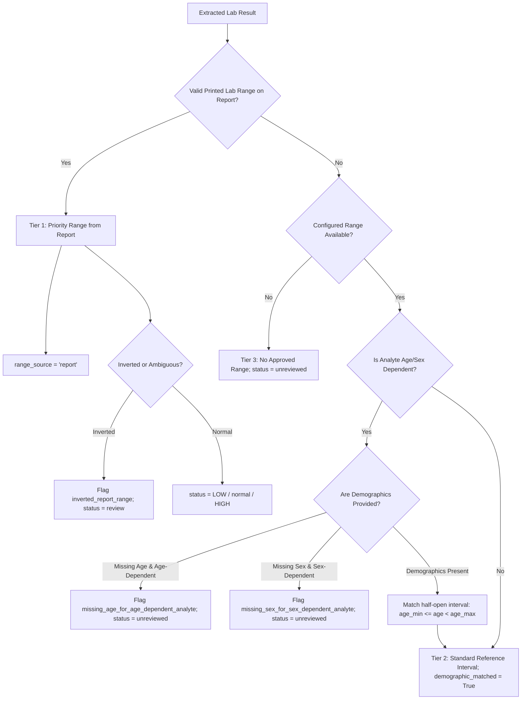

# Phase 2: Demographic-Aware Reference Ranges & Clinical Laboratory Analysis

## 1. System Overview

MediSense AI implements demographic-aware medical reference-interval selection adhering to **CLSI EP28-A3c** (*Defining, Establishing, and Verifying Reference Intervals in the Clinical Laboratory*), Tietz Clinical Chemistry, and international pediatric/adult laboratory guidelines.

Biochemical and hematological analytes vary across human ontogeny, biological sex, analytical assay methods, and clinical populations. MediSense AI does not rely on static generic adult ranges or silently fabricate missing demographic values.

> **CLINICAL NOTICE:** MediSense AI provides informational clinical decision support and preliminary laboratory-result structuring. It is **NOT** a substitute for clinician interpretation, official hospital diagnostic workups, or clinical judgment.

---

## 2. Demographic Verification & Age Calculation

### Supported Demographics
- **Age**: Numeric years (or float representation for infants/children e.g. `0.5` = 6 months) or unit strings (`"6m"`, `"18y"`, `"14 days"`).
- **Date of Birth (DOB)**: ISO 8601 (`YYYY-MM-DD`) or common medical date notations (`DD/MM/YYYY`, `MM/DD/YYYY`).
- **Biological Sex**: `"male"`, `"female"` (and neutral handling for other/unspecified).

### Age Calculation Rules
1. When **Date of Birth** is provided, age is calculated relative to a reference date (defaulting to the current date, e.g. `2026-10-29`):
   $$\text{Age (years)} = \frac{\text{Reference Date} - \text{Date of Birth}}{365.2425 \text{ days}}$$
2. **Safety & Sanity Safeguards**:
   - Future birth dates ($\text{DOB} > \text{Reference Date}$) are rejected with an explicit error.
   - Negative ages are rejected.
   - Implausible ages ($> 130$ years) are rejected as biological outliers.
   - If both DOB and explicit Age are provided and diverge by more than 1.1 years, a conflict error is raised.
   - Missing age or sex is **never** silently fabricated or defaulted to adult values.

---

## 3. Reference-Interval Selection Priority & Precedence

For each extracted analyte, the engine (`AI-model/src/core/reference_range_engine.py`) follows strict three-tier precedence:



### Precedence Rules:
1. **Tier 1 — Laboratory-Provided Reference Range (`range_source='report'`)**:
   - If the patient's physical report prints a legible reference interval (e.g. `40–80%` for neutrophils), that laboratory-specific interval **supersedes** standard fallback ranges.
   - Protects against cross-laboratory analyzer variance (e.g., Beckman Coulter vs. Sysmex vs. Roche Cobas).
   - If the report range is inverted ($\text{ref\_lo} > \text{ref\_hi}$), it is flagged as `inverted_report_range` with status `review` and interpretation `requires review`.
2. **Tier 2 — Approved Demographic-Matched Interval (`range_source='standard_reference'`)**:
   - Matches half-open age intervals $[age_{min}, age_{max})$ using exact continuous age.
   - Distinguishes male vs. female intervals for sex-dependent analytes (e.g. Hemoglobin, Ferritin, Uric Acid, Creatinine, PSA).
3. **Tier 3 — Missing or Incomplete Demographics**:
   - If an analyte strictly requires age (e.g., Alkaline Phosphatase) or sex (e.g., Hemoglobin), and the required demographic is omitted, the analyte is **not** forced into an adult range.
   - It is assigned `status: "unreviewed"` with `interpretation: "unable to determine"`, and flagged with `missing_age_for_age_dependent_analyte` or `missing_sex_for_sex_dependent_analyte`.
   - *Clinical Exception*: If a value is unequivocally elevated beyond all pediatric and adult upper limits (e.g. ALP 380 U/L), it is interpreted as `"HIGH"` with an advisory `"missing_age_demographic"` review flag.

---

## 4. Authoritative Clinical References & Data Sources

All demographic intervals in `AI-model/config/reference_ranges.json` are referenced from peer-reviewed clinical laboratory authorities:

| Analyte | Age / Population Groups | Source Authority | Citation / Link |
| :--- | :--- | :--- | :--- |
| **Hemoglobin** | Neonate, Infant, Child, Adolescent, Adult M/F | WHO Guidelines & Tietz Textbook | [WHO Haemoglobin Concentrations](https://www.who.int/publications/i/item/WHO-NMH-NHD-MNM-11.1) |
| **PCV / Hematocrit** | Pediatric, Adult M/F | CLSI EP28-A3c | [CLSI Standards](https://clsi.org/standards/products/method-evaluation/documents/ep28/) |
| **WBC** | Neonate (9-30k), Infant (6-17.5k), Child (4.5-13.5k), Adult (4-10k) | Nelson Pediatrics & Tietz | [Nelson Textbook of Pediatrics](https://www.elsevier.com) |
| **Platelets** | Neonates (150-450k), Children & Adults (150-400k) | CLSI EP28-A3c | [CLSI EP28-A3c](https://clsi.org/standards/products/method-evaluation/documents/ep28/) |
| **Alkaline Phosphatase (ALP)**| Infant (110-360), Child (100-350), Adolescent, Adult (44-147) | IFCC Clinical Reference Values | [IFCC](https://ifcc.org/) |
| **Creatinine** | Child (0.3-0.7), Adolescent, Adult M (0.7-1.3), Adult F (0.5-1.1) | NKF KDOQI Guidelines | [National Kidney Foundation](https://www.kidney.org/) |
| **Ferritin** | Adult M (30-400), Adult F (15-150) | WHO Nutritional Anemias | [WHO Ferritin Guidelines](https://www.who.int/publications/i/item/9789240008526) |
| **Uric Acid** | Adult M (3.4-7.0), Adult F (2.4-6.0) | American College of Rheumatology | [ACR Guidelines](https://rheumatology.org/) |
| **PSA** | Adult Males (0-4.0 ng/mL); Inapplicable for females | AUA / NCCN Clinical Practice Guidelines | [AUA Guidelines](https://www.auanet.org/) |

---

## 5. API Response Schema (Phase 2 Additions)

The Flask endpoint `POST /analyze-report` accepts multipart form parameters:
- `file`: Lab report image/PDF.
- `age`: Optional patient age.
- `sex` / `gender`: Optional patient biological sex (`"male"` / `"female"`).
- `dob` / `date_of_birth`: Optional patient date of birth.

### Structured Finding Object Contract
```json
{
  "parameter": "Hemoglobin",
  "value": 14.5,
  "unit": "g/dL",
  "normal_range": "13.5–17.5",
  "status": "normal",
  "range_source": "standard_reference",
  "is_fallback_range": true,
  "hint": null,
  "disease_hint": null,
  "reported_range": null,

  "extracted_value": 14.5,
  "normalized_value": 14.5,
  "ref_lo": 13.5,
  "ref_hi": 17.5,
  "interpretation": "within reference interval",
  "demographic_matched": true,
  "review_flags": [],
  "review_reasons": []
}
```

### Neutral Interpretation Vocabulary
- `"within reference interval"` (Normal)
- `"below reference interval"` (Low)
- `"above reference interval"` (High)
- `"requires review"` (Unit mismatch, conflicting ranges, or inverted intervals)
- `"unable to determine"` (Missing required demographics or unconfigured analyte)

---

## 6. How to Add a New Validated Reference Interval

To add or update an analyte reference range in `config/reference_ranges.json`:

1. Locate or create the analyte key under the root JSON object.
2. Provide standard top-level `"male"` and `"female"` ranges and `"unit"` for backward compatibility.
3. Add the `"intervals"` array containing age-bracketed objects:
```json
"intervals": [
  {
    "age_min": 0.0,
    "age_max": 18.0,
    "description": "Pediatric (0-17 years)",
    "male": [lo, hi],
    "female": [lo, hi],
    "unit": "unit_string",
    "source": "Authoritative Organization"
  },
  {
    "age_min": 18.0,
    "age_max": 150.0,
    "description": "Adult (18+ years)",
    "male": [lo, hi],
    "female": [lo, hi],
    "unit": "unit_string",
    "source": "Authoritative Organization"
  }
]
```
4. Include metadata: `"source"`, `"citation_url"`, `"reviewed_date"`, and `"population"`.
5. Run test verification: `python -u tests/runner.py`.
