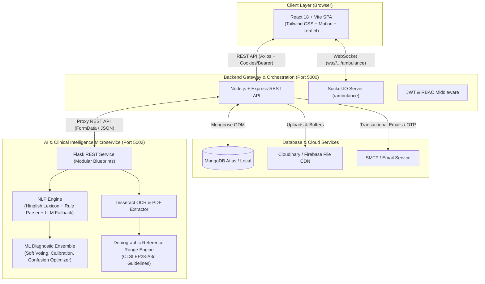
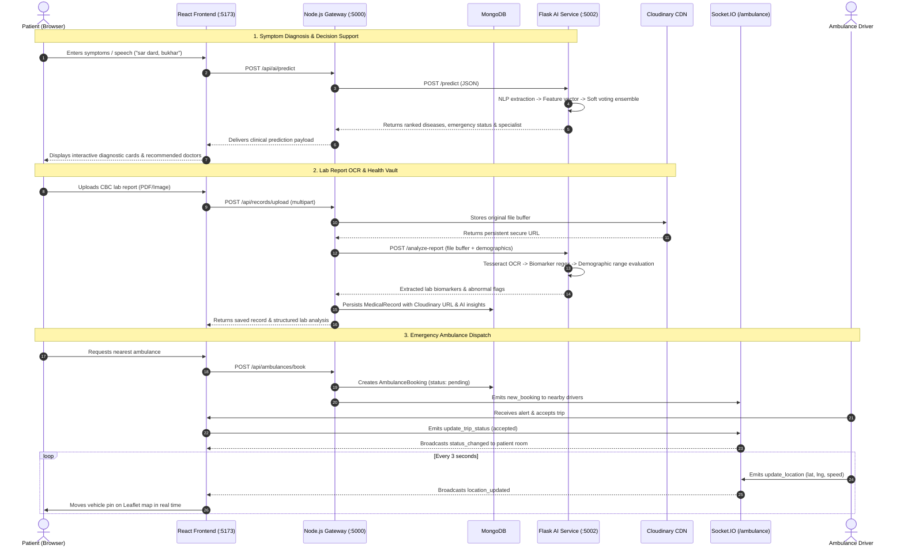

# Nirogya Sathi / MediSense AI — Comprehensive Project Architecture & System Reference

> **Unified Medical Ecosystem**: Patient Care, Multi-Provider Healthcare Network, Real-Time Emergency Logistics, and Clinical Decision Support AI.

---

## Table of Contents
1. [System Overview & Architecture](#1-system-overview--architecture)
2. [Complete Project Folder & File Tree](#2-complete-project-folder--file-tree)
3. [Deep-Dive File Responsibilities](#3-deep-dive-file-responsibilities)
   - [3.1 Root & Utilities](#31-root--utilities)
   - [3.2 Backend Service (`backend/`)](#32-backend-service-backend)
   - [3.3 AI Model & Clinical Intelligence Service (`AI-model/`)](#33-ai-model--clinical-intelligence-service-ai-model)
   - [3.4 Frontend Client (`frontend/`)](#34-frontend-client-frontend)
4. [Complete API Endpoints Reference](#4-complete-api-endpoints-reference)
   - [4.1 Backend REST API (`/api/...`)](#41-backend-rest-api-api)
   - [4.2 AI Model Microservice API (`:5002`)](#42-ai-model-microservice-api-5002)
   - [4.3 Real-Time WebSocket Events (`/ambulance` Namespace)](#43-real-time-websocket-events-ambulance-namespace)
5. [End-to-End Communication & Data Flows](#5-end-to-end-communication--data-flows)
   - [5.1 Core Architecture & Communication Topology](#51-core-architecture--communication-topology)
   - [5.2 Flow 1: Authentication & Role-Based Authorization](#52-flow-1-authentication--role-based-authorization)
   - [5.3 Flow 2: AI Symptom Diagnosis & Doctor Recommendation](#53-flow-2-ai-symptom-diagnosis--doctor-recommendation)
   - [5.4 Flow 3: Lab Report OCR & Demographic-Aware Biomarker Extraction](#54-flow-3-lab-report-ocr--demographic-aware-biomarker-extraction)
   - [5.5 Flow 4: Medical Vault & Cloudinary Record Summarization](#55-flow-4-medical-vault--cloudinary-record-summarization)
   - [5.6 Flow 5: Real-Time Ambulance Booking & Live GPS Dispatch](#56-flow-5-real-time-ambulance-booking--live-gps-dispatch)
   - [5.7 Flow 6: Healthcare Provider Lifecycle & Appointment Booking](#57-flow-6-healthcare-provider-lifecycle--appointment-booking)
6. [Environment Configuration & Startup Commands](#6-environment-configuration--startup-commands)

---

## 1. System Overview & Architecture

**Nirogya Sathi (MediSense AI)** is an integrated, production-grade digital healthcare platform built with a high-performance 3-tier microservice architecture:



### Architectural Highlights
1. **Frontend (React 18 + Vite)**: Role-aware SPA with dedicated dashboards for Patients, Doctors, Ambulance Drivers, Blood Banks, Labs, and Platform Administrators. Real-time Leaflet map integration for live ambulance tracking.
2. **Backend (Node.js + Express + Socket.IO)**: Central controller gateway handling authentication, role-based access control (RBAC), database mutations with MongoDB/Mongoose, file uploads via Cloudinary, and bi-directional WebSocket rooms for emergency ambulance dispatch.
3. **AI Service (Python 3.12+ Flask Microservice)**: Clinical decision-support system featuring a multi-model ensemble (XGBoost, Random Forest, Neural Networks, Soft Voting), bilingual Hinglish/English symptom extraction, automated specialist matching, and an OCR lab parser with demographic-aware reference intervals (age, gender, and date of birth).

---

## 2. Complete Project Folder & File Tree

Below is the directory tree of the workspace (`c:\Collage\Nsd`), including authored source files, config files, data assets, and model binaries:

```text
Nsd/
├── tesseract-ocr-setup.exe                 # Windows Tesseract OCR installer binary
├── tesseract-setup.exe                     # Alternative Windows Tesseract installer binary
│
├── AI-model/                               # Python Flask Machine Learning & OCR Microservice
│   ├── app.py                              # Service entrypoint (WSGI & Dev runner on port 5002)
│   ├── requirements.txt                    # Python runtime and ML dependencies
│   ├── README.md                           # AI architecture and clinical documentation
│   ├── .env.example                        # AI service environment template
│   ├── .gitignore                          # Python-specific ignore rules
│   │
│   ├── config/                             # AI Configuration & Clinical Rules
│   │   ├── __init__.py                     # Package initialization
│   │   ├── settings.py                     # Central paths, ports, model directories, and limits
│   │   ├── reference_ranges.json           # Clinical reference ranges by demographic cohort
│   │   └── medical_protocols.json          # Critical alert thresholds and clinical protocols
│   │
│   ├── src/                                # Modular AI Source Code
│   │   ├── api/                            # Web API Layer
│   │   │   ├── app.py                      # Flask Application Factory & Blueprint registration
│   │   │   └── routes/                     # Blueprint Route Handlers
│   │   │       ├── system_routes.py        # Healthcheck, root, and symptom normalization
│   │   │       ├── prediction_routes.py    # /predict and /follow_up disease diagnosis
│   │   │       └── report_routes.py        # /analyze-report OCR & lab intelligence
│   │   │
│   │   ├── core/                           # Core Diagnostic & Decision Support Logic
│   │   │   ├── predictor.py                # Model loader, soft voting ensemble, and post-processor
│   │   │   ├── features.py                 # Vectorizer for symptoms, body systems, and vitals
│   │   │   ├── emergency.py                # Red-flag symptom & biomarker triage calculator
│   │   │   ├── specialist_matcher.py       # Doctor and specialty matching engine
│   │   │   ├── reference_range_engine.py   # Demographic range parser (Age, DOB, Sex, Units)
│   │   │   └── session_manager.py          # Diagnostic session state for multi-turn triage
│   │   │
│   │   ├── nlp/                            # Natural Language Processing Engine
│   │   │   ├── extractor.py                # Main symptom & entity extraction pipeline
│   │   │   ├── hinglish_lexicon.py         # Bilingual English/Hindi/Hinglish phrase dictionary
│   │   │   ├── rule_parser.py              # Regex and pattern-based symptom matcher
│   │   │   └── llm_fallback.py             # Optional LLM fallback for ambiguous medical text
│   │   │
│   │   ├── ocr/                            # Optical Character Recognition & Lab Intelligence
│   │   │   ├── lab_parser.py               # Complete blood count (CBC) & biomarker parser
│   │   │   └── tesseract_engine.py         # Multi-page PDF & image OCR preprocessor
│   │   │
│   │   └── storage/                        # In-Memory & Persistent Session Cache
│   │       └── session_store.py            # Temporary storage for multi-turn follow-up chat
│   │
│   ├── data/                               # Clinical Datasets
│   │   ├── raw/                            # Supervised disease-symptom datasets
│   │   │   ├── clinical_dataset_corrected.csv
│   │   │   └── Disease and symptoms dataset.csv
│   │   └── reference/                      # Provider directory datasets
│   │       └── gwalior_doctors_dataset.csv
│   │
│   ├── model_artifacts/                    # Serialized Machine Learning Ensemble
│   │   ├── models.pkl                      # Trained model ensemble binaries
│   │   ├── label_encoder.pkl               # Disease name to index mapper
│   │   ├── feature_names.pkl               # Ordered input feature names vector
│   │   ├── weights.pkl                     # Ensemble model voting weights
│   │   ├── class_priors.pkl                # Epidemiological priors for calibration
│   │   ├── disease_symptom_profile.pkl     # Disease-to-symptom correlation matrix
│   │   ├── confusion_optimizer.pkl         # Disambiguation rules for lookalike diseases
│   │   └── reports/                        # Model evaluation & performance metrics
│   │       ├── summary_metrics.json        # Overall accuracy, F1, and log loss
│   │       ├── per_class_metrics.csv       # Precision/recall per pathology
│   │       ├── confusion_matrix.csv        # Multi-class confusion matrix
│   │       └── calibration_summary.json    # Probability calibration metrics
│   │
│   ├── scripts/                            # Operational & Training Scripts
│   │   ├── train_model.py                  # Offline training pipeline to generate artifacts
│   │   └── check_tesseract.py              # Environment diagnostic tool for Tesseract OCR
│   │
│   ├── tests/                              # Automated Test Suites
│   │   ├── runner.py                       # Unified test runner
│   │   ├── test_api.py                     # Flask HTTP endpoint tests
│   │   ├── test_features.py                # Feature extraction unit tests
│   │   ├── test_nlp.py                     # Hinglish and symptom parsing tests
│   │   ├── test_emergency.py               # Critical triage and emergency rule tests
│   │   ├── test_demographic_ranges.py      # Demographic range & age cohort tests
│   │   ├── test_cbc_regression.py          # CBC biomarker parser regression suite
│   │   └── test_ocr_cases.py               # Image and PDF OCR extraction test cases
│   │
│   ├── templates/
│   │   └── index.html                      # Standalone Flask debug & preview web interface
│   │
│   └── uploads/                            # Runtime buffer directory for uploaded medical reports
│
├── backend/                                # Node.js + Express + Socket.IO REST Gateway
│   ├── package.json                        # Backend scripts and npm dependencies
│   ├── package-lock.json                   # Deterministic dependency tree
│   ├── .env                                # Local secrets and database configuration
│   ├── .gitignore                          # Git ignore rules for Node
│   ├── eng.traineddata                     # Bundled Tesseract English OCR language model
│   ├── fix-indexes.js                      # Database maintenance & MongoDB index migration
│   ├── seed.js                             # Root seed utility
│   │
│   └── src/                                # Backend Source Architecture
│       ├── server.js                       # HTTP server bootstrap, Socket.IO & database connection
│       ├── app.js                          # Express app configuration, security, and routes mounting
│       ├── seed.js                         # Core MongoDB seed script for default doctors/users
│       ├── seedAmbulance.js                # Seed script for demo ambulances and drivers
│       │
│       ├── config/                         # Application Configuration
│       │   ├── db.js                       # Mongoose connection with error handling
│       │   ├── env.js                      # Environment variable validation & defaults
│       │   └── cloudinary.js               # Cloudinary storage setup for medical files
│       │
│       ├── controllers/                    # Business Logic Request Handlers
│       │   ├── authController.js           # Register, login, current user (/me), password reset
│       │   ├── userController.js           # Patient profile, avatar upload, notifications
│       │   ├── doctorController.js         # Doctor catalog, specialty search, profile updates
│       │   ├── bookingController.js        # Appointment booking, lifecycle, and cancellations
│       │   ├── hospitalController.js       # Hospital listings and geolocation discovery
│       │   ├── labController.js            # Lab test catalog, bookings, and report status
│       │   ├── bloodBankController.js      # Blood stock search and urgent blood requests
│       │   ├── ambulanceController.js      # Ambulance search, dispatch, trip status, driver ops
│       │   ├── recordController.js         # Medical vault storage, CRUD, and AI summarization
│       │   ├── providerController.js       # Provider onboarding applications and profiles
│       │   ├── adminController.js          # Platform analytics, user/doctor moderation, approvals
│       │   ├── reviewController.js         # Doctor ratings, patient reviews, and moderation
│       │   ├── notificationController.js   # User alerts, mark-as-read, and deletions
│       │   └── aiController.js             # Gateway proxy connecting frontend to Python AI service
│       │
│       ├── middleware/                     # Express Interceptors & Guards
│       │   ├── authMiddleware.js           # JWT verification and user population (`req.user`)
│       │   ├── roleMiddleware.js           # Role-based access control (`authorize('admin', ...)`)
│       │   ├── validateMiddleware.js       # Request payload schema validation runner
│       │   ├── rateLimiter.js              # IP-based rate limiting for security
│       │   ├── errorMiddleware.js          # Global error handler and standardized JSON response
│       │   └── notFoundMiddleware.js       # 404 handler for unrecognized routes
│       │
│       ├── models/                         # Mongoose Schemas & Models
│       │   ├── User.js                     # Patient, Doctor, Driver, Provider & Admin schema
│       │   ├── Doctor.js                   # Doctor specialty, experience, fees, availability
│       │   ├── Hospital.js                 # Hospital facilities, beds, coordinates, contacts
│       │   ├── Lab.js                      # Diagnostic laboratory test catalog & pricing
│       │   ├── LabProvider.js              # Lab facility profile & licensing
│       │   ├── BloodBank.js                # Blood bank inventory by blood group (A+, O-, etc.)
│       │   ├── BloodBankProvider.js        # Blood bank facility profile & operating hours
│       │   ├── Ambulance.js                # Vehicle details, driver link, live coordinates, status
│       │   ├── AmbulanceProvider.js        # Ambulance fleet operator company schema
│       │   ├── AmbulanceBooking.js         # Emergency trip booking, pickup/drop, tracking logs
│       │   ├── Booking.js                  # Unified appointment schema (Doctor, Lab, Ambulance)
│       │   ├── MedicalRecord.js            # Health vault document metadata, Cloudinary URL, summary
│       │   ├── Review.js                   # Patient feedback and 1-5 star ratings for doctors
│       │   └── Notification.js             # User notifications with read/unread flags
│       │
│       ├── routes/                         # Express Route Definitions
│       │   ├── authRoutes.js               # /api/auth
│       │   ├── userRoutes.js               # /api/users
│       │   ├── doctorRoutes.js             # /api/doctors
│       │   ├── bookingRoutes.js            # /api/bookings
│       │   ├── hospitalRoutes.js           # /api/hospitals
│       │   ├── labRoutes.js                # /api/lab-tests
│       │   ├── bloodBankRoutes.js          # /api/bloodbanks
│       │   ├── ambulanceRoutes.js          # /api/ambulances
│       │   ├── recordRoutes.js             # /api/records
│       │   ├── providerRoutes.js           # /api/providers
│       │   ├── adminRoutes.js              # /api/admin
│       │   ├── reviewRoutes.js             # /api/reviews
│       │   ├── notificationRoutes.js       # /api/notifications
│       │   └── aiRoutes.js                 # /api/ai
│       │
│       ├── services/                       # External Service Integrations
│       │   ├── aiSummaryService.js         # Calls AI service to summarize medical vault records
│       │   ├── ambulanceSimulator.js       # Live ambulance GPS movement simulator for demos
│       │   ├── emailService.js             # Nodemailer integration for OTP and confirmations
│       │   ├── firebaseUploadService.js    # Firebase storage fallback integration
│       │   ├── notificationService.js      # Creates and delivers in-app notification alerts
│       │   └── otpService.js               # One-time password generator and validator
│       │
│       ├── sockets/                        # Real-Time WebSocket Logic
│       │   └── ambulanceSocket.js          # Socket.IO handlers for live GPS tracking & dispatch
│       │
│       ├── utils/                          # Helper Utilities
│       │   ├── asyncHandler.js             # Wraps async handlers to catch unhandled rejections
│       │   ├── generateToken.js            # Signs JWT tokens with configured secret and expiry
│       │   └── logger.js                   # Structured application logging utility
│       │
│       └── validators/                     # Request Validation Schemas
│           ├── authValidator.js            # Input validation for registration and login
│           ├── bookingValidator.js         # Input validation for appointments
│           └── doctorValidator.js          # Input validation for doctor profile creation
│
└── frontend/                               # React 18 + Vite Single Page Application
    ├── index.html                          # HTML5 browser mount document
    ├── package.json                        # Frontend dependencies and build scripts
    ├── package-lock.json                   # Locked npm dependency graph
    ├── vite.config.js                      # Vite server and build bundler configuration
    ├── eslint.config.js                    # ESLint linting configuration
    ├── postcss.config.mjs                  # PostCSS configuration for Tailwind
    │
    ├── src/                                # Frontend Source Code
    │   ├── main.jsx                        # React root bootstrap and DOM render
    │   │
    │   ├── app/                            # Application Core
    │   │   ├── App.jsx                     # Central router, layout frame, and role guards
    │   │   │
    │   │   ├── context/                    # React Context State Providers
    │   │   │   └── AuthContext.jsx         # Global user session, token, login, and logout state
    │   │   │
    │   │   ├── routes/                     # Specialized Route Guards
    │   │   │   └── ProviderRoute.jsx       # Route guard for provider onboarding workflows
    │   │   │
    │   │   ├── utils/                      # Utilities & API Client
    │   │   │   └── api.js                  # Centralized Axios client with JWT interceptors
    │   │   │
    │   │   ├── pages/                      # Page Components (Routes)
    │   │   │   ├── Home.jsx                # Landing page with hero, search, and feature highlights
    │   │   │   ├── Login.jsx               # User authentication (email/password)
    │   │   │   ├── Register.jsx            # Patient and provider registration
    │   │   │   ├── Dashboard.jsx           # Role-based dispatcher routing to specific dashboard
    │   │   │   ├── Doctors.jsx             # Doctor directory with filters (specialty, rating, city)
    │   │   │   ├── DoctorProfile.jsx       # Doctor detailed bio, reviews, and appointment booking
    │   │   │   ├── DoctorProfileSettings.jsx# Doctor practice hours, fees, and bio settings
    │   │   │   ├── Hospitals.jsx           # Hospital discovery and emergency emergency contacts
    │   │   │   ├── LabTests.jsx            # Diagnostic tests catalog and sample collection booking
    │   │   │   ├── BloodBank.jsx           # Blood bank directory and urgent blood request form
    │   │   │   ├── Ambulance.jsx           # Emergency ambulance service landing and request entry
    │   │   │   ├── SymptomCheckerPage.jsx  # AI symptom checker, voice input, and report OCR analysis
    │   │   │   ├── MedicalVault.jsx        # Patient health vault, document storage, and AI summary
    │   │   │   ├── Profile.jsx             # User account profile overview
    │   │   │   ├── PatientProfileSettings.jsx# Patient personal info, medical history, emergency contact
    │   │   │   ├── JoinAsProvider.jsx      # Provider recruitment entry page
    │   │   │   ├── ProviderOnboarding.jsx  # Provider application form (Ambulance, Lab, BloodBank)
    │   │   │   ├── ProviderProfile.jsx     # Public profile view for verified healthcare providers
    │   │   │   ├── ProviderProfileSettings.jsx# Provider operational settings and fleet management
    │   │   │   ├── NotFound.jsx            # 404 error page
    │   │   │   │
    │   │   │   ├── user/                   # Patient-specific emergency workflows
    │   │   │   │   ├── AmbulanceBooking.jsx# Emergency location selection and ambulance confirmation
    │   │   │   │   └── LiveTracking.jsx    # Real-time Leaflet map tracking ambulance arrival
    │   │   │   │
    │   │   │   └── driver/                 # Driver-specific workflows
    │   │   │       └── DriverDashboard.jsx # Driver trip dispatcher, status toggle, and route navigation
    │   │   │
    │   │   └── components/                 # Reusable UI Components
    │   │       ├── ai/                     # AI Symptom Checker Components
    │   │       │   ├── SymptomInput.jsx    # Text input with autocomplete and tag management
    │   │       │   ├── VoiceInput.jsx      # Web Speech API speech-to-text voice listener
    │   │       │   ├── ReportUpload.jsx    # Drag-and-drop PDF/image report upload with progress
    │   │       │   ├── ResultsPanel.jsx    # Disease probability cards, severity, and triage alert
    │   │       │   ├── ConfidenceMeter.jsx # Visual gauge showing prediction confidence
    │   │       │   ├── DoctorRecommendations.jsx# Matched specialist cards with instant booking
    │   │       │   ├── FindSpecialistModal.jsx# Filtered specialist modal for identified pathologies
    │   │       │   ├── FollowUpChat.jsx    # Conversational triage for differential diagnosis
    │   │       │   └── DiagnosticSkeleton.jsx# Animated skeleton loader during inference
    │   │       │
    │   │       ├── ambulance/              # Ambulance UI Components
    │   │       │   └── MapContainer.jsx    # Leaflet interactive map with custom vehicle pins
    │   │       │
    │   │       ├── common/                 # Global UI Elements
    │   │       │   ├── Navbar.jsx          # Header navigation, role-based links, and profile badge
    │   │       │   ├── Footer.jsx          # Platform footer, disclosures, and emergency hotline
    │   │       │   ├── EmergencyFloat.jsx  # Floating quick-action button for 1-click ambulance
    │   │       │   ├── GeneralBookingForm.jsx# Generic appointment scheduling modal form
    │   │       │   ├── Loader.jsx          # Global loading spinner
    │   │       │   ├── ErrorMessage.jsx    # Standardized error alert banner
    │   │       │   └── SuspensionBanner.jsx# Warning banner displayed for suspended accounts
    │   │       │
    │   │       ├── dashboard/              # Role-Specific Dashboards
    │   │       │   ├── PatientDashboard.jsx# Appointments, health records, and quick actions
    │   │       │   ├── DoctorDashboard.jsx # Scheduled consultations, patient history, approvals
    │   │       │   ├── AmbulanceDashboard.jsx# Fleet overview, driver status, and active dispatches
    │   │       │   ├── LabDashboard.jsx    # Incoming test bookings, sample tracking, report upload
    │   │       │   ├── BloodBankDashboard.jsx# Stock levels by blood type and urgent request queue
    │   │       │   ├── AdminDashboard.jsx  # Platform metrics, provider verification, user bans
    │   │       │   ├── AppointmentDetailsModal.jsx# Comprehensive modal for appointment inspection
    │   │       │   ├── ProviderProfileModal.jsx# Inspection modal for pending provider approvals
    │   │       │   ├── RecordsList.jsx     # Paginated table of uploaded medical records
    │   │       │   └── HealthRecordUpload.jsx# Quick-upload dialog for medical documents
    │   │       │
    │   │       ├── doctors/                # Doctor Components
    │   │       │   └── DoctorCard.jsx      # Doctor bio card with rating, fee, and booking button
    │   │       │
    │   │       └── vault/                  # Medical Vault Components
    │   │           ├── VaultCard.jsx       # Health document card with file preview & tag badges
    │   │           ├── UploadModal.jsx     # File upload modal with category picker
    │   │           └── SummaryModal.jsx    # AI summary viewer for structured clinical insights
    │   │
    │   ├── hooks/                          # Custom React Hooks
    │   │   └── useAmbulanceSocket.js       # Manages Socket.IO connection, room join, and GPS streams
    │   │
    │   ├── styles/                         # CSS & Design System
    │   │   ├── index.css                   # Root stylesheet entry
    │   │   ├── globals.css                 # Base resets, Tailwind directives, and animations
    │   │   ├── tailwind.css                # Tailwind utility layers
    │   │   ├── theme.css                   # Nirogya color tokens (Primary, Secondary, Success, Danger)
    │   │   └── fonts.css                   # Custom typography rules
    │   │
    │   └── assets/                         # Static Artwork & Logos
    │       ├── logo.png                    # Nirogya Sathi brand logo
    │       ├── hero-bg.png                 # Hero background illustration
    │       ├── hero-cute.png               # Healthcare visual asset
    │       └── hero-new.png                # Modern hero promotional graphic
```

---

## 3. Deep-Dive File Responsibilities

### 3.1 Root & Utilities
- `tesseract-ocr-setup.exe` & `tesseract-setup.exe`: Pre-packaged Windows installers for the Tesseract 5.x engine. Required by `AI-model` to execute OCR on scanned physical prescriptions and lab reports.

---

### 3.2 Backend Service (`backend/`)

#### Core Entry & Config
- `backend/src/server.js`: Application root. Connects to MongoDB via Mongoose, initializes the Express HTTP server, attaches the Socket.IO WebSocket instance, registers the `/ambulance` tracking namespace, initializes the ambulance movement simulator for testing, and starts listening on `PORT` (default: 5000).
- `backend/src/app.js`: Configures Express application middleware including `helmet` (HTTP headers security), `cors` (origin validation for the frontend), body parsers (`express.json({ limit: '10mb' })`), `cookieParser`, MongoDB query sanitization (`express-mongo-sanitize`), HTTP parameter pollution protection (`hpp`), API rate limiting, mounts all 14 `/api/...` route modules, and binds global error handling middleware.
- `backend/src/config/db.js`: Establishes the asynchronous connection to MongoDB using `process.env.MONGO_URI` with reconnection resilience.
- `backend/src/config/env.js`: Centralized environment variable loader and validator. Checks for critical secrets (`MONGO_URI`, `JWT_SECRET`, `CLOUDINARY_API_KEY`) and fails gracefully on startup if essential secrets are missing in production.
- `backend/src/config/cloudinary.js`: Configures the Cloudinary SDK using API keys from environment variables and exports the configured Cloudinary instance for document storage.
- `backend/src/seed.js` & `backend/src/seedAmbulance.js`: Database seeding utilities that populate demo records for admin users, doctors, hospitals, labs, blood banks, ambulances, and mock appointments.
- `backend/fix-indexes.js`: Utility script to clean up or rebuild outdated MongoDB indexes.

#### Controllers (`backend/src/controllers/`)
- `authController.js`: Manages user lifecycle including registration (`/register`), password hashing (bcrypt), login (`/login`), user credential verification, cookie management, session recovery (`/me`), and password reset workflows.
- `userController.js`: Handles patient profile retrieval, profile updates (contact details, address, medical history), and patient profile picture uploads.
- `doctorController.js`: Provides doctor discovery, filtering by medical specialty, experience, fees, and location, fetching doctor details, and allowing doctors to update their practice availability and profiles.
- `bookingController.js`: Core appointment engine for scheduling doctor consultations and lab appointments. Validates date/time conflicts, updates booking status (`pending`, `confirmed`, `completed`, `cancelled`), and notifies participants.
- `hospitalController.js`: Handles hospital queries and geospatial lookup (`/nearby`) to locate trauma centers and emergency rooms near patient GPS coordinates.
- `labController.js`: Manages the lab test catalog, test pricing, diagnostic appointments, and lab result delivery.
- `bloodBankController.js`: Coordinates blood bank inventories across blood groups (`A+`, `A-`, `B+`, `B-`, `AB+`, `AB-`, `O+`, `O-`), processes urgent blood requests from patients, and tracks inventory levels.
- `ambulanceController.js`: Manages emergency ambulance dispatch, discovers available ambulances near patient coordinates (`/nearby`), books ambulances, assigns drivers, updates trip status, and tracks driver trips.
- `recordController.js`: Manages the patient's personal Medical Vault. Handles encrypted uploads of prescriptions and lab reports to Cloudinary, fetches document lists, updates metadata, and triggers AI summaries.
- `providerController.js`: Manages healthcare provider onboarding applications (`/apply`), profile updates, and catalog discovery for external clinics, labs, and ambulance operators.
- `adminController.js`: Platform governance controller. Provides system-wide analytics, reviews pending doctor licenses and provider applications, verifies or rejects credentials, and handles account suspension.
- `reviewController.js`: Allows verified patients to submit ratings and reviews for doctors, aggregates doctor star averages, and allows admins to remove abusive reviews.
- `notificationController.js`: Fetches in-app alerts for users and providers, marks notifications as read, and removes obsolete alerts.
- `aiController.js`: Gateway proxy connecting the frontend to the Python AI service. Forwards symptom predictions (`/predict`), multi-turn triage (`/follow_up`), and streams multipart lab report uploads to Python for OCR extraction.

#### Middleware (`backend/src/middleware/`)
- `authMiddleware.js`: Intercepts requests, extracts the JWT from the `Authorization: Bearer <token>` header or HTTP-only cookies, verifies the token signature, and attaches the active user document to `req.user`.
- `roleMiddleware.js`: Role-based authorization gate. Accepts allowed roles (e.g. `authorize('admin', 'doctor')`) and rejects unauthorized requests with a `403 Forbidden` status.
- `validateMiddleware.js`: Validates incoming request payloads against predefined validator schemas and returns structured validation error messages on bad input.
- `rateLimiter.js`: Protects authentication and public endpoints from brute-force attacks by restricting requests per IP address within sliding time windows.
- `errorMiddleware.js`: Global Express error handler. Catches unhandled exceptions, logs errors, and returns clean, uniform `{ success: false, message: ... }` JSON payloads without leaking internal stack traces in production.
- `notFoundMiddleware.js`: Catches requests to nonexistent routes and returns a standardized `404 Not Found` response.

#### Models (`backend/src/models/`)
- `User.js`: Base identity collection storing `name`, `email`, `password` (bcrypt hashed), `phone`, `role` (`'user' | 'doctor' | 'ambulance' | 'lab' | 'bloodbank' | 'admin'`), status (`'active' | 'suspended'`), and timestamps.
- `Doctor.js`: Doctor profiles linked to `User.js`, storing `specialization`, `experience`, `qualifications`, `fees`, `hospitalAffiliation`, `verificationStatus` (`'pending' | 'verified' | 'rejected'`), and `rating`.
- `Hospital.js`: Hospitals and trauma centers, storing `name`, `address`, `location` (GeoJSON coordinates `[lng, lat]`), `emergencyHotline`, `bedCapacity`, and `services`.
- `Lab.js` & `LabProvider.js`: Diagnostic centers and individual test offerings (test name, sample type, preparation instructions, pricing).
- `BloodBank.js` & `BloodBankProvider.js`: Blood facilities and stock levels per blood type with urgent request tracking.
- `Ambulance.js` & `AmbulanceProvider.js`: Emergency vehicles, license numbers, equipment types (`'BLS' | 'ALS'`), driver assignment, `isOnline`, `isBusy`, and `liveLocation` (GeoJSON Point).
- `AmbulanceBooking.js` & `Booking.js`: Appointment and emergency bookings recording patient details, provider IDs, pickup/drop coordinates, fare, status, and tracking history.
- `MedicalRecord.js`: Documents uploaded to the Medical Vault storing `patientId`, `title`, `category` (`'prescription' | 'lab_report' | 'scan' | 'discharge'`), `fileUrl` (Cloudinary), and `aiSummary`.
- `Review.js`: Reviews linked to doctors, storing `patientId`, `rating` (1-5 stars), `comment`, and `createdAt`.
- `Notification.js`: System alerts linked to `userId` with `title`, `message`, `type`, and `read` status.

#### Services (`backend/src/services/`)
- `aiSummaryService.js`: Downloads documents from Cloudinary, sends them to the Python AI service, and structures the resulting analysis into a clinically relevant summary for storage in `MedicalRecord.js`.
- `ambulanceSimulator.js`: Emulates realistic driver GPS movement along road vectors for demo environments and tests real-time WebSocket delivery.
- `emailService.js`: Nodemailer wrapper sending transactional emails, OTP verification codes, and appointment confirmation emails.
- `otpService.js`: Generates cryptographic 6-digit numeric OTPs with a 5-minute time-to-live and verifies them upon submission.
- `notificationService.js`: Utility to persist notifications to MongoDB and emit live alerts to connected clients.

#### Sockets (`backend/src/sockets/`)
- `ambulanceSocket.js`: Real-time WebSocket handler for the `/ambulance` namespace. Manages driver connections, room joining (`booking:<id>`, `driver:<id>`, `user:<id>`), broadcasts driver GPS updates (`update_location` -> `location_updated`), and handles trip lifecycle transitions.

---

### 3.3 AI Model & Clinical Intelligence Service (`AI-model/`)

#### Entry & Configuration
- `AI-model/app.py`: Production entrypoint. Imports the application factory from `src.api.app`, configures settings, and runs the WSGI server on port 5002.
- `AI-model/config/settings.py`: Central path and environment coordinator. Defines `BASE_DIR`, `UPLOAD_DIR`, model artifact paths (`artifacts/models/` or `model_artifacts/`), doctor directory paths, Anthropic API key, Tesseract executable path, and 32MB upload limits.
- `AI-model/config/reference_ranges.json`: Demographic reference ranges for laboratory biomarkers (Hemoglobin, WBC, Platelets, Fasting Glucose, HbA1c, etc.) categorized by age group (`neonate`, `infant`, `child`, `adolescent`, `adult`, `elderly`) and sex (`male`, `female`).
- `AI-model/config/medical_protocols.json`: Critical clinical thresholds and red-flag rules (e.g. Platelets < 20,000/μL -> Critical Emergency Alert).

#### Web API Layer (`AI-model/src/api/`)
- `src/api/app.py`: Flask application factory. Enables CORS, sets request size limits, and registers blueprints (`system_bp`, `prediction_bp`, `report_bp`).
- `src/api/routes/system_routes.py`: Provides `/health` (service status, model readiness, Tesseract verification), `/` (root diagnostic message), and `/normalize-input` (converts raw symptom text into canonical symptom tokens).
- `src/api/routes/prediction_routes.py`:
  - `POST /predict`: Receives symptom descriptions, duration, severity, and vitals. Runs NLP extraction, vectorization, and ensemble inference to return ranked disease predictions, confidence metrics, and doctor recommendations.
  - `POST /follow_up`: Manages multi-turn triage sessions by asking targeted clarifying questions to differentiate between lookalike conditions.
- `src/api/routes/report_routes.py`:
  - `POST /analyze-report`: Accepts uploaded medical reports (PDF, PNG, JPG, WebP) along with patient demographics (age, sex, DOB). Executes OCR extraction, parses biomarkers, applies demographic reference ranges, flags abnormal values, identifies red flags, and maps extracted findings into diagnostic predictions.

#### Core Logic (`AI-model/src/core/`)
- `predictor.py`: Diagnostic engine. Loads serialized model artifacts (`models.pkl`, `label_encoder.pkl`, `weights.pkl`), executes soft voting across ensemble models, applies class priors, and evaluates confusion pairs to return calibrated disease probabilities.
- `features.py`: Inference vectorizer. Converts canonical symptoms, body system flags, and vital signs into a 132+ dimensional numerical feature vector matching the training feature space.
- `emergency.py`: Clinical safety gate. Inspects symptoms and vital signs for red-flag conditions (e.g., severe chest pain radiating to left arm, shortness of breath, systolic BP > 180) and generates immediate emergency triage directives.
- `specialist_matcher.py`: Recommends appropriate medical specialists (Cardiologist, Neurologist, Dermatologist, etc.) based on predicted pathologies and matches doctors from `gwalior_doctors_dataset.csv`.
- `reference_range_engine.py`: Evaluates clinical laboratory reference intervals following CLSI EP28-A3c guidelines:
  1. Uses laboratory-stated reference intervals from the report when clearly printed.
  2. Otherwise calculates exact patient age from Date of Birth (DOB) or age inputs, determines the age group, and looks up the age- and sex-specific reference range in `reference_ranges.json`.
  3. Classifies biomarker values as `NORMAL`, `LOW`, `HIGH`, or `CRITICAL` and outputs delta values and clinical interpretations.
- `session_manager.py`: In-memory state manager tracking active multi-turn diagnosis sessions.

#### NLP Pipeline (`AI-model/src/nlp/`)
- `extractor.py`: Multi-stage NLP processor. Cleans incoming text, normalizes slang, detects negation ("no fever", "without headache"), extracts symptom severity, and maps colloquial phrases to canonical symptoms.
- `hinglish_lexicon.py`: Medical lexicon mapping 350+ colloquial Hindi, English, and Hinglish phrases to standard clinical terminology (e.g. *"sar dard"* -> `"headache"`, *"pet kharab"* -> `"diarrhea"`, *"chhati me dard"* -> `"chest_pain"`).
- `rule_parser.py`: Fast regex parser extracting duration ("for 3 days"), frequency, and vital signs (BP, pulse, SpO2, temperature) from natural text.
- `llm_fallback.py`: External LLM fallback (Claude/Groq) for interpreting complex, ambiguous, or rare clinical narratives when rule-based parsing has low confidence.

#### OCR & Lab Parser (`AI-model/src/ocr/`)
- `tesseract_engine.py`: OCR pipeline. Uses `pdf2image` and `pytesseract` to preprocess documents (deskewing, adaptive thresholding, contrast enhancement) and extract raw text from image files and multi-page PDFs.
- `lab_parser.py`: Regex extraction engine for laboratory panels (Complete Blood Count, Lipid Profile, Liver Function, Kidney Function, Blood Sugar). Extracts biomarker names, observed values, and measurement units (`g/dL`, `cells/mcL`, `mg/dL`).

---

### 3.4 Frontend Client (`frontend/`)

#### Core Architecture
- `src/main.jsx`: Browser entry point. Mounts the root React component into the DOM inside `index.html`.
- `src/app/App.jsx`: Top-level application layout. Configures `react-router-dom` routes, wraps components in `AuthProvider`, displays `Navbar`, `Footer`, and `EmergencyFloat`, and manages protected route navigation.
- `src/app/context/AuthContext.jsx`: Global authentication context. Persists the active user profile and JWT token in `localStorage`, attaches tokens to outgoing requests, and provides `login()`, `register()`, and `logout()` functions.
- `src/app/routes/ProviderRoute.jsx`: Route guard allowing only verified healthcare providers or unassigned users to access provider onboarding workflows.
- `src/app/utils/api.js`: Centralized Axios instance pointing to `VITE_API_URL` (default: `http://localhost:5000/api`). Configures request interceptors to attach `Authorization: Bearer <token>`, manages global error responses (displaying toast notifications), and exports domain-specific API clients:
  - `authAPI`, `doctorsAPI`, `bookingsAPI`, `healthRecordsAPI`, `labTestsAPI`, `hospitalsAPI`, `bloodBankAPI`, `ambulanceAPI`, `notificationsAPI`, `providerAPI`, `adminAPI`, and `aiAPI`.
- `src/hooks/useAmbulanceSocket.js`: React hook wrapping Socket.IO connection to `/ambulance`. Handles room subscriptions (`join_booking`, `join_user`), tracks live driver coordinates, and cleans up event listeners on unmount.

#### Pages (`src/app/pages/`)
- `Home.jsx`: Landing page featuring emergency quick-call buttons, specialty search, AI symptom checker teaser, and platform metrics.
- `Login.jsx` & `Register.jsx`: Authentication forms with role selection, form validation, and session initialization.
- `Dashboard.jsx`: Unified dashboard controller that inspects `user.role` and renders the corresponding view: `PatientDashboard`, `DoctorDashboard`, `AmbulanceDashboard`, `LabDashboard`, `BloodBankDashboard`, or `AdminDashboard`.
- `SymptomCheckerPage.jsx`: Interactive clinical triage page. Combines `SymptomInput`, `VoiceInput`, and `ReportUpload` with real-time prediction rendering, confidence gauges, specialist recommendations, and follow-up chat.
- `MedicalVault.jsx`: Secure health records repository where patients can upload prescriptions/lab reports, view Cloudinary-hosted documents, and read AI-generated summaries.
- `Doctors.jsx` & `DoctorProfile.jsx`: Doctor catalog with specialty search, availability calendar, and appointment booking form.
- `Hospitals.jsx`, `LabTests.jsx`, `BloodBank.jsx`: Discovery and booking pages for regional medical facilities, lab tests, and blood stock.
- `user/AmbulanceBooking.jsx` & `user/LiveTracking.jsx`: Emergency ambulance booking form with GPS location detection and live Leaflet tracking of dispatched vehicles.
- `driver/DriverDashboard.jsx`: Ambulance driver interface for toggling availability (`online`/`offline`), accepting emergency requests, and updating trip status (`dispatched` -> `arrived` -> `in_transit` -> `completed`).

---

## 4. Complete API Endpoints Reference

### 4.1 Backend REST API (`/api/...`)
Base URL: `http://localhost:5000/api`

| Route Prefix | Method | Endpoint | Auth / Role | Description |
| :--- | :--- | :--- | :--- | :--- |
| **`/auth`** | `POST` | `/api/auth/register` | Public | Register new patient or provider account |
| | `POST` | `/api/auth/login` | Public | Authenticate user, set cookie, and return JWT |
| | `GET` | `/api/auth/me` | Authenticated | Retrieve current user profile and session data |
| | `POST` | `/api/auth/forgot-password`| Public | Generate and send password reset OTP via email |
| | `POST` | `/api/auth/reset-password` | Public | Reset password using verified OTP |
| **`/users`** | `GET` | `/api/users/profile` | Authenticated | Get detailed profile of logged-in user |
| | `PATCH`| `/api/users/profile` | Authenticated | Update profile details (phone, address, vitals) |
| | `POST` | `/api/users/upload-avatar`| Authenticated | Upload user profile avatar to Cloudinary |
| | `GET` | `/api/users/notifications`| Authenticated | Get notifications for logged-in user |
| **`/doctors`** | `GET` | `/api/doctors` | Public | Search/filter doctors by specialty, rating, fee |
| | `GET` | `/api/doctors/specializations` | Public | List all available medical specialties |
| | `GET` | `/api/doctors/:id` | Public | Get public profile and reviews for a doctor |
| | `PATCH`| `/api/doctors/profile` | Doctor | Update doctor bio, schedule, and consultation fee |
| | `POST` | `/api/doctors/upload-avatar`| Doctor | Upload doctor profile photo to Cloudinary |
| **`/bookings`**| `POST` | `/api/bookings` | Authenticated | Create new doctor or lab test appointment |
| | `GET` | `/api/bookings/my` | Authenticated | Get paginated appointments for logged-in user |
| | `GET` | `/api/bookings/upcoming` | Authenticated | Get next upcoming appointment for user |
| | `GET` | `/api/bookings/:id` | Authenticated | Get specific appointment details |
| | `PUT` | `/api/bookings/:id/cancel` | Authenticated | Cancel booking with required cancellation reason |
| | `PUT` | `/api/bookings/:id/status` | Doctor/Admin | Update booking status (`confirmed`, `completed`) |
| **`/hospitals`**| `GET`| `/api/hospitals` | Public | List all registered hospitals and clinics |
| | `GET` | `/api/hospitals/nearby` | Public | Find hospitals near given `lat` and `lng` coordinates |
| **`/lab-tests`**| `GET` | `/api/lab-tests` | Public | List lab tests catalog with pricing and preparation |
| | `GET` | `/api/lab-tests/:id` | Public | Get specific lab test details |
| | `POST` | `/api/lab-tests/book-test` | Authenticated | Book a diagnostic lab test |
| | `PATCH`| `/api/lab-tests/bookings/:id/status` | Lab / Admin | Update test sample status and attach report URL |
| **`/bloodbanks`**| `GET`| `/api/bloodbanks` | Public | Get blood banks filtered by group and city |
| | `GET` | `/api/bloodbanks/search` | Public | Search available blood units by blood group |
| | `GET` | `/api/bloodbanks/:id` | Public | Get blood bank details and current stock |
| | `POST` | `/api/bloodbanks/request` | Authenticated | Submit urgent request for blood units |
| **`/ambulances`**| `GET`| `/api/ambulances/nearby` | Authenticated | Locate nearest available ambulances |
| | `POST` | `/api/ambulances/book` | Authenticated | Request emergency ambulance pickup |
| | `GET` | `/api/ambulances/booking/:id` | Authenticated | Get booking and live tracking status |
| | `PUT` | `/api/ambulances/booking/:id/respond`| Ambulance Driver| Accept or decline emergency ride request |
| | `PUT` | `/api/ambulances/booking/:id/status` | Ambulance Driver| Update trip status (`dispatched`, `arrived`, etc.)|
| | `GET` | `/api/ambulances/driver/current-trip`| Ambulance Driver| Get driver's active trip details |
| | `PATCH`| `/api/ambulances/location` | Ambulance Driver| Update driver's live GPS coordinates |
| **`/records`** | `POST` | `/api/records/upload` | Authenticated | Upload medical document to Cloudinary & Vault |
| | `GET` | `/api/records/my` | Authenticated | Get all health records for logged-in user |
| | `GET` | `/api/records/:id` | Authenticated | Get metadata for a specific record |
| | `PUT` | `/api/records/:id` | Authenticated | Update record metadata (title, category) |
| | `DELETE`| `/api/records/:id` | Authenticated | Delete record from database and Cloudinary |
| | `POST` | `/api/records/:id/summarize`| Authenticated | Trigger AI summarization for stored record |
| **`/providers`**| `POST`| `/api/providers/apply` | Authenticated | Submit application for new provider role |
| | `GET` | `/api/providers/profile` | Provider | Get logged-in provider's operational profile |
| | `PUT` | `/api/providers/profile` | Provider | Update provider profile details |
| | `GET` | `/api/providers/:type` | Public | List verified providers by type |
| | `GET` | `/api/providers/:type/:id` | Public | Get public details for a verified provider |
| **`/admin`** | `GET` | `/api/admin/analytics` | Admin | Get platform-wide usage metrics and KPIs |
| | `GET` | `/api/admin/bookings` | Admin | List all platform bookings across all types |
| | `GET` | `/api/admin/doctors` | Admin | List all registered doctors |
| | `GET` | `/api/admin/doctors/pending` | Admin | List doctor applications awaiting verification |
| | `PATCH`| `/api/admin/doctors/:id/verify` | Admin | Approve and verify doctor license |
| | `PATCH`| `/api/admin/doctors/:id/reject` | Admin | Reject doctor application with reason |
| | `PATCH`| `/api/admin/doctors/:id/suspend`| Admin | Suspend doctor privileges |
| | `PATCH`| `/api/admin/doctors/:id/activate`| Admin | Re-activate suspended doctor |
| | `GET` | `/api/admin/providers` | Admin | List all provider applications |
| | `PATCH`| `/api/admin/providers/:type/:id/approve` | Admin | Approve provider application |
| | `PATCH`| `/api/admin/providers/:type/:id/reject` | Admin | Reject provider application |
| | `GET` | `/api/admin/users` | Admin | List all registered users |
| | `DELETE`| `/api/admin/users/:id` | Admin | Delete or ban user account |
| **`/reviews`** | `GET` | `/api/reviews/:doctorId`| Public | Fetch all reviews and ratings for a doctor |
| | `POST` | `/api/reviews` | Authenticated | Submit rating and feedback for a doctor |
| | `DELETE`| `/api/reviews/:id` | Admin | Remove inappropriate or abusive review |
| **`/notifications`**| `GET`| `/api/notifications` | Authenticated | List all notifications for current user |
| | `PATCH`| `/api/notifications/:id/read` | Authenticated | Mark single notification as read |
| | `PATCH`| `/api/notifications/read-all` | Authenticated | Mark all notifications as read |
| | `DELETE`| `/api/notifications/:id` | Authenticated | Delete notification |
| **`/ai`** | `POST` | `/api/ai/predict` | Authenticated | Proxy to AI microservice for disease prediction |
| | `POST` | `/api/ai/follow_up` | Authenticated | Proxy to AI service for differential triage |
| | `POST` | `/api/ai/normalize-input` | Authenticated | Proxy to AI service to parse symptom phrases |
| | `POST` | `/api/ai/analyze-report` | Authenticated | Stream multipart report to AI service for OCR |

---

### 4.2 AI Model Microservice API (`:5002`)
Base URL: `http://localhost:5002`

| Method | Endpoint | Request Payload | Response Structure | Purpose |
| :--- | :--- | :--- | :--- | :--- |
| `GET` | `/health` | None | `{ "status": "healthy", "service": "MediSense AI", "models_loaded": true, "tesseract_available": true }` | Service health, model status, and OCR readiness check |
| `POST` | `/normalize-input` | `{ "text": "bahut tez bukhar aur sar dard" }` | `{ "success": true, "symptoms": ["high_fever", "headache"], "vitals": {} }` | Normalizes Hindi/Hinglish text to canonical symptom tokens |
| `POST` | `/predict` | `{ "symptoms": ["chest_pain", "breathlessness"], "vitals": { "bp_sys": 140 } }` | `{ "predictions": [...], "emergency": { "is_emergency": true, ... }, "specialist": { "type": "Cardiologist", ... } }` | Runs ML ensemble inference and returns ranked disease predictions |
| `POST` | `/follow_up` | `{ "session_id": "...", "answer": "yes" }` | `{ "completed": false, "next_question": "...", "updated_predictions": [...] }` | Evaluates clarifying answers to narrow differential diagnoses |
| `POST` | `/analyze-report` | `multipart/form-data`<br/>- `file`: PDF/Image<br/>- `gender`/`sex`: `"male"`<br/>- `dob` or `age`: `"1994-05-12"` | `{ "success": true, "biomarkers": [...], "ml_prediction": [...], "demographics_applied": { "age": 30, "sex": "male", "cohort": "adult" } }` | Preprocesses document with OCR, extracts lab biomarkers, applies demographic reference ranges, and maps to disease predictions |

---

### 4.3 Real-Time WebSocket Events (`/ambulance` Namespace)
Socket Endpoint: `ws://localhost:5000/ambulance`

#### Client-to-Server Events
- `driver_online`: Payload `{ userId }`. Marks ambulance driver as active, updates vehicle status to `isOnline: true`, and joins rooms `driver:<userId>` and `provider:<providerId>`.
- `join_booking`: Payload `{ bookingId }`. Patient or driver joins the room `booking:<bookingId>` to send/receive live trip updates.
- `join_user`: Payload `{ userId }`. Patient joins personal notification channel `user:<userId>`.
- `update_location`: Payload `{ userId, lat, lng, bookingId, speed, heading }`. Driver transmits current GPS coordinates. Server saves coordinates to MongoDB and broadcasts updates to the booking room.
- `update_trip_status`: Payload `{ bookingId, status, location }`. Driver advances trip state (`accepted`, `arrived`, `in_transit`, `completed`, `cancelled`). Server updates booking record and notifies all room subscribers.
- `driver_offline`: Payload `{ userId }`. Driver goes off duty; marks vehicle as `isOnline: false`.

#### Server-to-Client Events
- `location_updated`: Broadcast to `booking:<bookingId>`. Payload `{ lat, lng, speed, heading, timestamp }`. Used by patient's Leaflet map to update vehicle position.
- `status_changed`: Broadcast to `booking:<bookingId>`. Payload `{ bookingId, status, timestamp }`. Updates trip status on the tracking UI.
- `booking_status_update`: Emitted directly to `user:<userId>`. Payload `{ bookingId, status }`. Displays in-app status updates for the patient.

---

## 5. End-to-End Communication & Data Flows

### 5.1 Core Architecture & Communication Topology
The diagram below illustrates how client interactions propagate through the system:



---

### 5.2 Flow 1: Authentication & Role-Based Authorization
1. **User Submission**: The user submits credentials on `/login` or `/register`.
2. **Gateway Processing**: `backend/src/routes/authRoutes.js` routes the request to `authController.js`. Passwords are encrypted using `bcrypt.hash()` with 10 salt rounds.
3. **Token Issuance**: On successful authentication, `generateToken.js` signs a JWT containing `{ id: user._id, role: user.role }` with an expiration (e.g. 30 days).
4. **Client Storage & State**: The JWT token and basic profile are returned to the client and stored in `localStorage`. `AuthContext.jsx` updates the session state across the app.
5. **Authenticated Requests**: Subsequent API calls route through `frontend/src/app/utils/api.js`. An Axios request interceptor injects the header:
   `Authorization: Bearer <token>`.
6. **Backend Verification**: `authMiddleware.js` decodes the token, loads the user from MongoDB, and attaches it to `req.user`. `roleMiddleware.js` verifies permissions (e.g. `authorize('admin')`), returning `403 Forbidden` if unauthorized.

---

### 5.3 Flow 2: AI Symptom Diagnosis & Doctor Recommendation
1. **Input Collection**: On `/symptom-checker`, the patient inputs symptoms using:
   - Text descriptions (e.g. *"I have severe chest tightness and left arm pain for 2 days"*)
   - Multilingual voice input (captured via Web Speech API in `VoiceInput.jsx`)
   - Direct symptom tags (e.g. `['chest_pain', 'breathlessness']`)
2. **API Proxy**: Frontend calls `aiAPI.predict()`, sending the payload to the Node backend at `/api/ai/predict`. Node forwards the request to Python at `http://localhost:5002/predict`.
3. **NLP Processing (`AI-model/src/nlp/`)**:
   - `extractor.py` tokenizes text and cross-references `hinglish_lexicon.py` to translate colloquial expressions (e.g., *"chhati me dard"* -> `chest_pain`).
   - `rule_parser.py` extracts symptom duration, frequency, and vital signs.
4. **Feature Engineering (`AI-model/src/core/features.py`)**:
   - Maps canonical symptoms onto the 132-element feature vector.
   - Calculates affected body-system scores (cardiovascular, respiratory, gastrointestinal, etc.).
5. **Ensemble Model Inference (`AI-model/src/core/predictor.py`)**:
   - Evaluates the feature vector against trained models (Random Forest, XGBoost, Neural Network).
   - Combines predictions using soft voting with learned ensemble weights (`weights.pkl`).
   - Adjusts probabilities using epidemiological priors (`class_priors.pkl`) and resolves lookalike conditions using `confusion_optimizer.pkl`.
6. **Safety & Specialist Matching**:
   - `emergency.py` scans for red-flag symptoms and sets `is_emergency: true` with a triage directive if critical thresholds are met.
   - `specialist_matcher.py` identifies the relevant medical specialty and selects top doctors from `gwalior_doctors_dataset.csv`.
7. **Frontend Display**: `ResultsPanel.jsx` displays ranked conditions, confidence meters, critical alerts, and instant booking links via `DoctorRecommendations.jsx`.

---

### 5.4 Flow 3: Lab Report OCR & Demographic-Aware Biomarker Extraction

```mermaid
graph LR
    A["Patient Uploads Lab Report<br/>(PDF or Image)"] --> B["Node.js Express /api/ai/analyze-report<br/>(Multer Memory Buffer)"]
    B --> C["Python Service /analyze-report<br/>(Preprocesses File)"]
    C --> D["Tesseract OCR Engine<br/>(pdf2image + Contrast Enhancement)"]
    D --> E["Regex Lab Parser<br/>(Extracts Biomarkers, Values, Units)"]
    E --> F["Demographic Range Engine<br/>(Calculates Age from DOB & Evaluates Cohort)"]
    F --> G["Classification<br/>(NORMAL / LOW / HIGH / CRITICAL)"]
    G --> H["ML Diagnostic Bridge<br/>(Maps Abnormalities to Disease Predictions)"]
    H --> I["Frontend Results Table<br/>(Biomarker Table, Flags, & Clinical Warnings)"]
```


1. **Upload & Forwarding**: The patient uploads a lab report (PDF/Image) on `/symptom-checker`. `ReportUpload.jsx` sends a multipart form request containing the file along with patient demographics (`gender`, `age`, `dob`) to `/api/ai/analyze-report`.
2. **Buffer Streaming**: Node passes the file buffer to Python's `/analyze-report` endpoint with a 120-second timeout.
3. **OCR Processing (`AI-model/src/ocr/`)**:
   - `tesseract_engine.py` converts PDF pages to images using `pdf2image`, applies grayscale conversion, contrast stretching, and Otsu adaptive thresholding, and runs `pytesseract` to extract raw text.
4. **Biomarker Extraction (`lab_parser.py`)**:
   - Regular expressions parse biomarkers (Hemoglobin, Platelets, Total Leukocyte Count, Fasting Blood Sugar, Creatinine, etc.), observed values, and units of measurement.
5. **Demographic Range Evaluation (`reference_range_engine.py`)**:
   - Uses lab-printed reference intervals from the report when clearly legible.
   - Otherwise calculates exact age from the patient's Date of Birth, determines demographic cohort (`neonate`, `child`, `adult`, `elderly`), and looks up age- and sex-specific reference ranges in `reference_ranges.json`.
   - Compares the observed value against standard intervals and assigns flags:
     - `NORMAL`: Value falls within reference interval.
     - `LOW` / `HIGH`: Value is outside normal thresholds.
     - `CRITICAL`: Value breaches safety thresholds defined in `medical_protocols.json`.
6. **Diagnostic Integration**: Abnormal biomarkers are mapped to canonical symptoms (e.g., Platelets < 50,000 -> `thrombocytopenia`) and fed into the ML model to generate disease predictions.
7. **Client Presentation**: Returns structured biomarkers, reference intervals, status badges (`HIGH`, `CRITICAL`), and linked diagnostic predictions to the UI.

---

### 5.5 Flow 4: Medical Vault & Cloudinary Record Summarization
1. **Upload**: In `MedicalVault.jsx`, the patient selects a document (PDF, PNG, JPG), chooses a category (`'prescription' | 'lab_report' | 'scan'`), and clicks Upload.
2. **Cloudinary Storage**: Node uploads the document to Cloudinary and obtains a persistent URL.
3. **Database Record**: `recordController.js` creates a `MedicalRecord` in MongoDB linking `patientId`, `fileUrl`, `title`, and `category`.
4. **On-Demand AI Summary**: When the patient clicks **"Generate AI Summary"**:
   - Node calls `aiSummaryService.js`, which forwards the document to Python for OCR extraction.
   - The AI identifies key findings, active medications, diagnoses, and follow-up instructions.
   - The summary is saved to `MedicalRecord.aiSummary` in MongoDB.
5. **Display**: `SummaryModal.jsx` displays the structured summary alongside the original document.

---

### 5.6 Flow 5: Real-Time Ambulance Booking & Live GPS Dispatch
1. **Emergency Booking**: On `/ambulance`, the patient's coordinates are detected via the browser Geolocation API. The patient confirms the pickup location and destination hospital, and clicks **"Book Ambulance"**.
2. **Booking Initialization**: Node's `ambulanceController.js` creates an `AmbulanceBooking` in MongoDB with status `pending`, identifies available ambulances near the pickup coordinates, and emits an emergency dispatch event over the `/ambulance` WebSocket namespace.
3. **Driver Notification**:
   - The assigned driver's dashboard (`DriverDashboard.jsx`) receives the emergency notification.
   - The driver clicks **Accept**.
   - The driver's client emits `update_trip_status` with status `accepted`.
4. **Live GPS Stream**:
   - The driver's device streams location updates (`update_location`) every 3 seconds with latitude, longitude, heading, and speed.
   - `ambulanceSocket.js` updates `Ambulance.liveLocation` in MongoDB and broadcasts `location_updated` to the room `booking:<bookingId>`.
5. **Real-Time Map Tracking**: The patient's tracking view (`LiveTracking.jsx`) subscribes to the booking room using `useAmbulanceSocket.js`. Received coordinates update the ambulance marker on the Leaflet map in real time.
6. **Trip Completion**: When the patient arrives at the emergency room, the driver sets the status to `completed`. The socket broadcasts the event, releases the vehicle (`isBusy: false`), and redirects the patient to the trip summary screen.

---

### 5.7 Flow 6: Healthcare Provider Lifecycle & Appointment Booking
1. **Application & Verification**:
   - A doctor or healthcare provider applies via `/join-provider` and `/onboarding/:type`.
   - `providerController.js` saves the application with `verificationStatus: 'pending'`.
   - An administrator reviews credentials, verified licenses, and operating certificates in `AdminDashboard.jsx`.
   - Upon admin approval, `adminController.js` sets `verificationStatus: 'verified'` and activates the provider profile.
2. **Patient Search & Discovery**:
   - Patients browse the doctor catalog on `/doctors`, filtering by specialty, rating, fee, or hospital affiliation.
   - `doctorController.js` returns verified doctors matching the search criteria.
3. **Scheduling & Confirmation**:
   - On `/doctor/:id`, the patient selects an available date/time slot and submits the booking form.
   - `bookingController.js` verifies that the slot is open, creates a `Booking` record with status `confirmed`, and creates a notification record in MongoDB.
4. **Consultation & Reviews**:
   - Following the appointment, the doctor marks the consultation as `completed`.
   - The patient is prompted to leave a rating and review on `DoctorProfile.jsx`.
   - `reviewController.js` updates the doctor's aggregate star rating in the database.

---

## 6. Environment Configuration & Startup Commands

### 6.1 Backend Configuration (`backend/.env`)
```ini
# Application Port & Environment
PORT=5000
NODE_ENV=development

# Database Connection
MONGO_URI=mongodb://localhost:27017/nirogya
# or MongoDB Atlas: mongodb+srv://<user>:<password>@cluster.mongodb.net/nirogya

# Authentication & Security
JWT_SECRET=super_secret_jwt_key_change_in_production
JWT_EXPIRE=30d
FRONTEND_URL=http://localhost:5173

# Python AI Microservice URL
PYTHON_AI_URL=http://localhost:5002

# Cloudinary Storage Configuration
CLOUDINARY_CLOUD_NAME=your_cloud_name
CLOUDINARY_API_KEY=your_api_key
CLOUDINARY_API_SECRET=your_api_secret

# Email (SMTP) Configuration
SMTP_HOST=smtp.gmail.com
SMTP_PORT=587
SMTP_USER=your_email@gmail.com
SMTP_PASS=your_email_app_password
EMAIL_FROM=noreply@nirogya.com
```

### 6.2 AI Service Configuration (`AI-model/.env`)
```ini
# Service Port & Host
PORT=5002
HOST=0.0.0.0
DEBUG=False

# OCR / Tesseract Path (for Windows if not in system PATH)
# TESSERACT_CMD=C:\Program Files\Tesseract-OCR\tesseract.exe

# Optional LLM Key for ambiguous symptom fallback
ANTHROPIC_API_KEY=your_anthropic_api_key
```

### 6.3 Frontend Configuration (`frontend/.env`)
```ini
# Backend API Gateway Base URL
VITE_API_URL=http://localhost:5000/api
```

---

### 6.4 Startup Commands Reference

To run the complete system locally, start the three services in separate terminals:

#### Terminal 1: AI Model Microservice (Port 5002)
```bash
cd c:\Collage\Nsd\AI-model

# 1. (Optional) Activate Virtual Environment
# venv\Scripts\activate

# 2. Install dependencies
pip install -r requirements.txt

# 3. (Optional) Verify Tesseract OCR installation
python scripts\check_tesseract.py

# 4. Start the AI service
python app.py
```

#### Terminal 2: Node.js Backend Gateway (Port 5000)
```bash
cd c:\Collage\Nsd\backend

# 1. Install dependencies
npm install

# 2. (Optional) Seed demo database records
node src/seed.js
node src/seedAmbulance.js

# 3. Start development server with hot-reload
npm run dev
```

#### Terminal 3: React Frontend Client (Port 5173)
```bash
cd c:\Collage\Nsd\frontend

# 1. Install dependencies
npm install

# 2. Start Vite development server
npm run dev
```

The web application will be accessible in your browser at `http://localhost:5173`.
